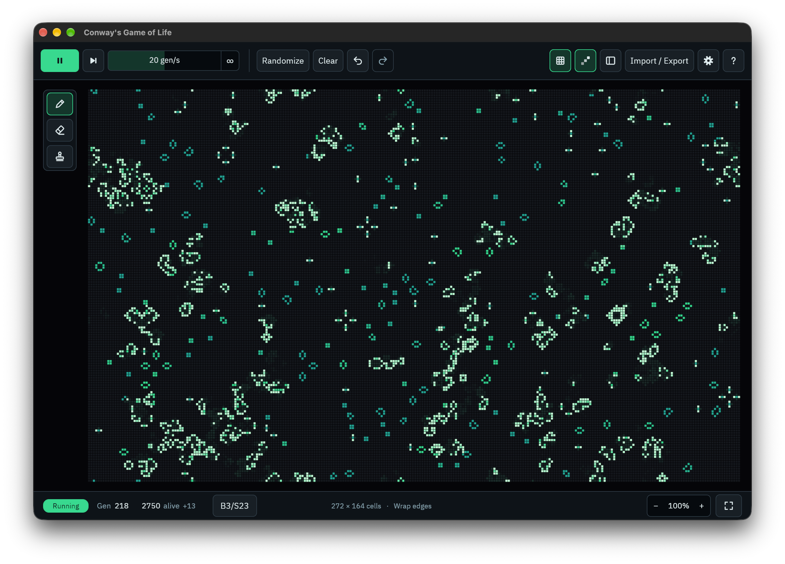
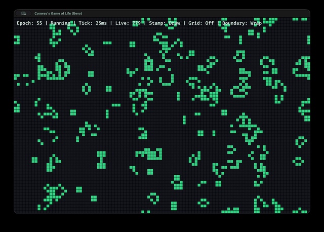

# Conway's Game of Life (Bevy)

Conway's Game of Life with a native desktop GUI built on Bevy.

The full documentation is at <https://andreashdez.github.io/gol_bevy/>.

## Demo





## Download

Each tagged release on the [GitHub Releases page](https://github.com/andreashdez/gol_bevy/releases)
has ready-to-run builds, so no Rust toolchain is needed: unpack the archive for your platform and run `gol-bevy`.

- **Linux (x86_64):** needs glibc 2.39 or newer (Ubuntu 24.04, Debian 13, Fedora 40, or
  later) and a Wayland or X11 desktop.
- **Windows (x86_64):** unzip and run `gol-bevy.exe`.
- **macOS (universal):** the binary is not signed, so macOS blocks it the first time.
  Either allow it under System Settings → Privacy & Security, or run
  `xattr -d com.apple.quarantine gol-bevy` in the unpacked folder.

## Quick start

```bash
cargo run
```

The interface uses native Bevy UI throughout: playback controls, a searchable pattern
palette, editing tools, live status, and import/settings/help/diagnostics dialogs.

The toolbar is a single 64-pixel row, grouped into playback, board edits, and workspace
controls. Below 900 pixels wide, the workspace controls move into a menu behind a **⋯**
button at the right end, and the pattern palette folds into its rail of tool icons. It comes
back when the window is wide again, unless you showed or hid it yourself in between.
Resizing preserves keyboard focus and the camera view relative to the fitted board.
The workspace group has icon toggles for the grid, cell age, and pattern palette, which show
whether they are on, plus Import / Export, a gear for Settings, and a ? for Help.
Play / Pause, Step, Undo, and Redo are icon buttons too; tooltips give their names and shortcuts.

The pattern library scrolls with the mouse wheel or its scrollbar; search and the
stamp preview with its rotate/flip controls stay visible while browsing. The stamp
preview appears under the search field, so selecting a stamp never moves it. Scrolling
over the canvas zooms it. Randomize and Clear are always available in the toolbar.
Draw, Erase, and Stamp live in a separate tool strip above the palette. Hiding the
palette turns that strip into a slim vertical rail of icons, so editing tools remain available.
The board has its own canvas beside the palette and between the toolbar and status
bar. Startup, board-size changes, **Fit board**, and **V** fit the entire board into that space.
The status bar's zoom stepper (**− 100% +**) zooms in steps; 100% means the whole-board
fit, and the corner-brackets button beside it is **Fit board**. Middle-button dragging
pans without editing cells.
Window and layout changes retain the pan position and zoom relative to the fitted
view. Drawing and stamp previews stay inside the canvas, including on Retina displays.
The built-in library covers spaceships, oscillators (blinker, pulsar, pentadecathlon), the
Gosper glider gun, and long-lived starters (R-pentomino, acorn, diehard).
Search patterns by name; built-in and imported patterns have separate groups. The
stamp preview shows the orientation that will be placed, including rotation and
horizontal flip. Filtering the library keeps the current stamp selected.

Speed runs from 1 to 40 gen/s, and its last stop is **∞**: as many generations as fit
in about 8 ms per frame. The chevrons beside the number decrease or increase speed by
1 gen/s; **›** at 40 goes to ∞ and **‹** at ∞ returns to 40, like **+** and **-** on the
keyboard. Drag sideways on the numeric speed field to scrub, past 40 to reach ∞;
hold Shift for finer adjustments. Escape during a drag restores the previous speed.
Click the field to enter a rate from 1–40 gen/s, including decimals, or `∞` (`max`
and `inf` work too): Enter applies it, Escape cancels, and leaving the field applies
a valid edited value. Invalid values leave the simulation speed unchanged. Fixed speeds
use millisecond intervals, so the field shows the closest achievable rate. At ∞, a
small readout under the field shows the rate actually achieved while running.
Hover or focus buttons for shortcut hints. Search and speed field focus block
board shortcuts; Escape returns keyboard control to the canvas.

Tab moves between visible, enabled native controls and Enter/Space activates the focused button;
click the canvas to return Space to playback. RLE import, help, diagnostics, and
workspace settings now use native Bevy dialogs. Escape closes a dialog;
typing and scrolling inside dialogs do not affect the board or camera.
Closing a dialog restores focus to its opener. Native fields expose names and values
to accessibility tools, buttons expose their actions and selected states, and inline
validation messages use polite live announcements. Editors support platform clipboard
shortcuts (Cmd on macOS, Ctrl elsewhere) and Shift+Arrow selection.

Open **Settings** to choose a board size preset or enter dimensions, then
apply the size. Invalid values are rejected with an inline message. Import drafts
remain available for the current session.

The rule is chosen in Settings as well: pick Life, HighLife, Day & Night, or Seeds, or
type any rulestring in B/S notation (`B36/S23`, or the older `23/36`). Changing the
rule is an undoable edit. Settings also switches between the Dark, Light, and High contrast
themes, which recolour both the board and the interface.

Settings also provides **Randomization**: a density slider from 0–100%, which applies as
it moves, and an optional seed from 0 to 18446744073709551615 with its own **Apply**. These
set the preferences for the toolbar's Randomize button and **R**; **Randomize now**
applies them and replaces the board immediately as one undoable edit. The default
is 25% with a blank seed, which uses a fresh seed each time. With a fixed seed,
the same density and board dimensions reproduce the same cell layout, independent
of other random operations. Density is a probability per cell, so the resulting
population is approximate; 0% clears the board and 100% fills it. Randomization
keeps the current rule, boundary mode, and generation counter.

Palette visibility, board size, rule, boundary mode, speed, randomization preferences, the grid, cell age, and the theme are saved between runs
in `settings.toml`, in a `gol-bevy` folder in the platform's settings location:

- Linux: `$XDG_CONFIG_HOME`, or `~/.config` if that is unset
- macOS: `~/Library/Application Support`
- Windows: `%APPDATA%`

Settings save after 500 ms without further changes, and pending changes flush on normal
app exit, including window close. Writes use a temporary file beside `settings.toml`
and replace it only after the complete contents have been flushed. Failed saves retain
the previous file and retry after a delay.

`GOL_BEVY_CONFIG_DIR` overrides the folder on every platform. Earlier versions saved
`ui_layout.toml`, at first in `~/.config/gol-bevy` everywhere; an old file is read
until the first save writes `settings.toml`, and is left alone. Entries that are
missing or unreadable keep their defaults.

**Import / Export** also copies the board to the clipboard as RLE: the live cells,
cropped to their bounding box, with the board rule in the header. The result pastes
back into Import, or into other Life tools such as Golly.

Import also opens `.rle` files into its fields, and previews the pasted or loaded RLE (a
thumbnail with its size, cell count, and rule) before you import it.

**Workspace files** in Import / Export provide **Save workspace…** (**Cmd/Ctrl+S**) and
**Open workspace…** (**Cmd/Ctrl+O**), which use the system file dialog. It starts in your Documents folder, then wherever you
last saved or opened a workspace, and asks before replacing an existing file. Saving
writes through a temporary file before replacing it. On Linux the file dialog comes
from xdg-desktop-portal, so a portal backend (such as xdg-desktop-portal-gtk or -kde)
must be installed.

A workspace preserves the full board dimensions and cell positions, generation, rule,
boundary mode, playback speed, randomization preferences, and imported patterns, including their names and rules.
Opening validates the whole file first, then asks before replacing your workspace.
Replacing pauses playback, clears undo/redo, and turns Fill canvas off so the loaded
dimensions stay intact. Display settings continue to use
`settings.toml`; selection, camera position, and cell-age trails are not stored.
Workspace files use versioned JSON with RLE cell data. Limits are 32 MiB per file,
256 imported patterns, 1024 bytes per pattern name, and 4,194,304 live cells across
the imported library. The board doesn't count toward the cell limit, so even a full
2048 × 2048 board can be saved. Import enforces the same library limits, so anything
you have imported can always be saved. Imported patterns can now be kept between runs by
saving a workspace; there is no automatic session recovery.

Local CI-equivalent checks:

```bash
just ci-local
```

## Controls

### Simulation

| Keys | Action |
| --- | --- |
| `Space` | Play / pause |
| `J` | Step one generation |
| `+` | Speed up |
| `−` | Slow down |
| `M` | Wrap / fixed edges |
| `0` | Reset generation counter |

### Editing

| Keys | Action |
| --- | --- |
| `1` | Draw tool |
| `2` | Erase tool |
| `3` | Stamp tool |
| `Left drag` | Draw or erase with the tool |
| `Right drag` | Erase |
| `R` | Randomize the board |
| `X` | Clear the board |
| `U` or `Cmd/Ctrl+Z` | Undo and pause |
| `Cmd/Ctrl+Shift+Z` | Redo |

### Stamps

| Keys | Action |
| --- | --- |
| `Click` | Place the stamp |
| `Z` | Rotate 90° clockwise |
| `F` | Flip horizontally |
| `C` | Put the stamp away and draw |

### Camera

| Keys | Action |
| --- | --- |
| `Wheel` | Zoom |
| `Middle drag` | Pan |
| `WASD` or `Arrow keys` | Pan |
| `V` | Fit board |

### Interface

| Keys | Action |
| --- | --- |
| `T` | Show / hide the grid |
| `H` | Show / hide the palette |
| `F3` | Diagnostics |
| `/` | Help |
| `Cmd/Ctrl+S` | Save workspace |
| `Cmd/Ctrl+O` | Open workspace |
| `Q` | Quit |

Board size is set in Settings: pick a preset (128², 256², 512², 1024²) or type exact dimensions, from 8 up to 2048 per side. The choice is saved between runs. **Fill canvas**, on by default, instead sizes the board to the canvas and keeps it matched as the window or palette changes. Resizing the board clears undo history, because old snapshots no longer fit; resizing the window does not, unless Fill canvas is on.

The playback toolbar shows speed in generations per second. Draw, Erase, and Stamp tools stay available independently of the pattern palette; rotate and flip controls appear in the palette for stamps. Use the Pattern palette toggle to show or hide the library. Grid and Cell age are available in the toolbar and Settings. Cell age, on by default, brightens newborn cells, deepens long-lived ones, and leaves fading trails where cells died; boundary mode is in Settings. The status bar shows a green Running or neutral Paused pill, the generation, the population with its change over the latest generation (for example `842 alive −12`), the rule, which opens Settings at the rulestring when clicked, and the cell under the pointer, plus board dimensions and boundary mode when space allows. Numbers use tabular digits and keep their widest size until the board is cleared or resized, so readouts stay close without shifting. The status
bar stays a single row at every window size. The active rule preset is highlighted in
Settings. Clear, randomize, undo, and redo show brief feedback, including the undo
shortcut where applicable. Diagnostics open from Settings or F3 and start hidden.

Undo restores the board, generation, and rule before drawing, erasing, placing a stamp, randomizing, clearing, changing the rule, or importing a pattern that changes the rule, and pauses playback. Redo reapplies an undone edit, and making a new edit discards the redo chain. Each drag is one edit. History retains up to 32 edits within an approximate 16 MiB budget (with at least one edit), and clears when the board is resized. Imported patterns remain available for the current session, or across sessions in saved workspace files.

## Architecture map

Runtime flow from `src/main.rs`:

```text
main
  -> DefaultPlugins + resources
  -> RenderPlugin (world setup, board texture/grid/wall/preview rendering)
  -> SettingsPlugin (palette visibility, board size, rule, boundary, speed, and grid persistence)
  -> UiInputPlugin (UI regions, modal capture, and keyboard focus)
  -> CanvasViewPlugin (canvas viewport and board framing)
  -> NativeUiPlugin (native toolbar + palette + import/settings/help/diagnostics dialogs)
  -> InputPlugin (keyboard, mouse, camera controls)
  -> SimulationPlugin (tick advancement, redraw collection, quit)

Shared resources:
  Simulation { app, accumulator, avg_step_ms, step_samples }
  BoardSettings { cols, rows }
  RedrawRequested
  DiagnosticsOverlay
  GridOverlay
  CellAge
  UiInputRegions / UiInputCapture

Core domain:
  app::App      (state machine and user actions)
  board::Board  (cell storage, stepping rules, dirty-cell tracking)
  patterns      (built-ins from assets/patterns/ + RLE parsing)
```

## Pattern system and RLE

Built-in patterns are RLE files in `assets/patterns/`. To add one to the palette, drop a
`.rle` file there and rebuild: `build.rs` embeds every file in the binary, so nothing is
read from disk at runtime. The palette lists them in file-name order, named by each
file's `#N` line, or by the file name if there is none.

RLE imports are limited to 8 MiB of source and 2048 cells per side. Runs must stay
within the declared header dimensions; zero counts, dangling counts, and numeric overflow
are rejected before expanding live-cell runs. Anything after the `!` terminator is ignored.

Supported RLE features:

- Header dimensions: `x = <width>, y = <height>`
- Comment lines starting with `#`; the first `#N` line names a built-in pattern
- Optional `rule = B3/S23` in the header, which an import applies to the board
- Run counts (`3o`, `10b`, `2$`)
- Row breaks (`$`) and terminator (`!`)

Example:

```text
x = 8, y = 4
8o$8o$8o$8o!
```

## Performance notes

- Board state is stored in a flat contiguous buffer for better cache locality.
- Board size is independent of the window unless Fill canvas is on. Otherwise resizing the window only changes how much of the board is visible.
- Stepping is adaptive: sparse generations use a frontier update (changed cells plus neighbors), while dense generations fall back to a full scan.
- The frontier path applies flipped cells in place instead of staging a full second buffer, so a sparse generation costs time proportional to the frontier rather than to the board area.
- Cells away from every edge take a neighbour-counting fast path of plain index offsets; only edge cells pay for wrapping or clamping.
- Population is tracked incrementally rather than rescanned, so the status bar does not walk the board every frame.
- Step buffers are recycled between generations, and dirty/frontier flags are cleared by index instead of by full-array fill.
- The dense scan runs in bands of whole rows on Bevy's compute task pool, one band per thread, with each band also marking its own changed cells dirty. A band reads only the current generation and writes only its own rows, so no locking is needed. Boards split only into bands of at least 64K cells: below that, the 15-20 µs it costs to dispatch them outweighs the work they share on a settled board.
- A dense step whose changes exceed the fallback threshold does not keep them as a frontier list, since the next step would take the dense scan anyway.
- Dense fallback threshold defaults to 5% candidate coverage and can be overridden with `GOL_FRONTIER_DENSE_THRESHOLD_PERCENT`. The dense scan is vectorizable while the frontier step pays per-candidate bookkeeping, so the scan wins early: around 2% for young soup and 5-6% for settled debris on small boards. `cargo bench --bench dense_crossover` measures both, and is worth re-running after changing either path. A frontier that is already over the threshold skips straight to the scan, and candidate collection stops as soon as it crosses it.
- Rendering is incremental: the board is drawn as a single texture with one texel per cell, and only changed cells are rewritten. Cell count no longer costs one sprite entity each.
- The grid overlay is drawn only for the lines that intersect the viewport, and is skipped entirely below a few pixels per cell, so its cost tracks screen area rather than board area.
- A frame runs at most 8 generations to catch up after a stall and then drops the backlog, so a slow frame cannot snowball into a frozen app. Max speed instead spends a fixed time budget per frame, capped at 1024 generations.
- Full redraw is still used as a safe fallback for operations like resize, randomize, and clear.

## Profiling and benchmarking

Baseline runs:

```bash
cargo run --release
cargo test --all-targets --all-features --locked
cargo bench --bench board_step --locked
```

CPU profiling options:

- macOS: use Instruments (`cargo run --release`, attach Time Profiler).
- Linux: use `perf` or `cargo flamegraph` (if installed).

Benchmark targets:

- `benches/board_step.rs`: `board::step` + dirty-cell extraction for sparse glider and deterministic noise scenarios across 256/512/1024 boards, plus a dense group that steps a freshly seeded 512/1024/2048 board each iteration so it always measures the dense scan.
- `benches/dense_crossover.rs`: times the frontier step against the dense scan on soup covering a growing share of the board, to tune the dense fallback threshold.

## Development

The Rust version is pinned in `rust-toolchain.toml` (currently 1.99.0), and CI uses
the matching `rust:1.99.0-trixie` image, so a new Rust release cannot change what
CI accepts. Inside the project, rustup picks the pinned version; if it is not
installed yet, run `rustup toolchain install` once. To move to a newer Rust, change
the version in both files together.

Dev builds optimize dependencies (`[profile.dev.package."*"] opt-level = 3`) so
Bevy stays responsive under `cargo run`; the first build is slower as a result.
For faster rebuilds while iterating, link Bevy dynamically:

```bash
cargo run --features bevy/dynamic_linking
```

Useful commands:

```bash
just fmt-check
just clippy
just test
just ci-local
```

### Releasing

Pushing a tag such as `v0.2.0` runs the usual checks, then builds Linux, Windows,
and universal macOS archives (Windows is cross-compiled with MinGW) and creates a
GitHub release with them attached:

```bash
git tag v0.2.0 && git push origin v0.2.0
```

To try the macOS release build locally, run `just release-macos v0.2.0`.
`scripts/package-release.sh` gives every platform the same archive layout:
the binary, this README, and the licence.
