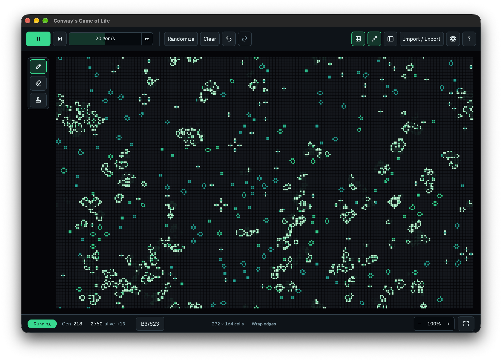

# Conway's Game of Life (Bevy)

Conway's Game of Life as a native desktop app for Linux, Windows, and macOS, built on
[Bevy](https://bevyengine.org).



The full documentation is at <https://andreashdez.github.io/gol_bevy/>, where you can also
[try it in your browser](https://andreashdez.github.io/gol_bevy/try-online/) without
installing anything.

## Features

- **Play, pause, and step** through generations, from 1 to 40 per second, or at ∞: as many
  generations as fit in each frame.
- **Draw, erase, and stamp** cells with the mouse. Stamps can be rotated and flipped, and
  the palette has a searchable pattern library.
- **Undo and redo** every edit, including rule changes and imports.
- **Any Life-like rule**: Life, HighLife, Day & Night, Seeds, or any rulestring in `B/S`
  notation.
- **Boards up to 2048 × 2048** with wrapping or fixed edges, or an **unbounded** board
  that grows as far as the pattern does.
- **RLE import and export**, compatible with other Life tools such as Golly, and
  workspace files that keep the board and imported patterns between runs.
- **PNG and GIF export** of the board or a selection, in the theme's colours.
- **Keyboard and screen reader friendly**: Tab navigation and accessible names on every
  control, a cell cursor for editing the board from the keyboard, and dark, light, and
  high-contrast themes.
- **Settings that persist**: board size, rule, edges, speed, grid, cell age, and theme.

## Download

Each tagged release on the [GitHub Releases page](https://github.com/andreashdez/gol_bevy/releases)
has ready-to-run builds, so no Rust toolchain is needed: unpack the archive for your platform and run `gol-bevy`.

- **Linux (x86_64):** needs glibc 2.36 or newer (Debian 12, Ubuntu 24.04, Fedora 37, or
  later) and a Wayland or X11 desktop. The file dialogs need an xdg-desktop-portal
  backend, such as xdg-desktop-portal-gtk or -kde.
- **Windows (x86_64):** unzip and run `gol-bevy.exe`.
- **macOS (universal):** the binary is not signed, so macOS blocks it the first time.
  Either allow it under System Settings → Privacy & Security, or run
  `xattr -d com.apple.quarantine gol-bevy` in the unpacked folder.

## Run from source

```bash
cargo run
```

The Rust version is pinned in `rust-toolchain.toml`; if rustup doesn't have it yet, run
`rustup toolchain install` once. The first build takes a while, because dependencies are fully optimized even in dev
builds. On Linux, Bevy needs a few system libraries first; see
[Building from source](https://andreashdez.github.io/gol_bevy/development/).

## Controls

### Simulation

| Keys | Action |
| --- | --- |
| `Space` | Play / pause |
| `J` | Step one generation |
| `G` | Jump to a generation |
| `B` | Reset to start |
| `+` | Speed up |
| `−` | Slow down |
| `M` | Wrap / fixed / unbounded edges |
| `0` | Reset generation counter |

### Editing

| Keys | Action |
| --- | --- |
| `1` | Draw tool |
| `2` | Erase tool |
| `3` | Stamp tool |
| `4` | Select tool |
| `Left drag` | Draw, erase, or select with the tool |
| `Right drag` | Erase |
| `Arrow keys` | Move the cell cursor (board focused with Tab) |
| `Enter` | Draw, erase, stamp, or select at the cursor |
| `R` | Randomize the board or view |
| `X` | Clear the board |
| `U` or `Cmd/Ctrl+Z` | Undo and pause |
| `Cmd/Ctrl+Shift+Z` | Redo |

### Stamps

| Keys | Action |
| --- | --- |
| `Click` | Place the stamp |
| `Z` | Rotate 90° clockwise |
| `F` | Flip horizontally |
| `C` | Put the stamp away and draw |

### Selection

| Keys | Action |
| --- | --- |
| `Cmd/Ctrl+A` | Select the live cells |
| `Cmd/Ctrl+C` | Copy the selection as RLE |
| `Cmd/Ctrl+X` | Cut the selection as RLE |
| `Cmd/Ctrl+V` | Paste RLE as the stamp |
| `Delete` or `Backspace` | Clear the selected cells |
| `Shift+arrow keys` | Extend the selection from the cursor |
| `Esc` | Deselect |

### Camera

| Keys | Action |
| --- | --- |
| `Wheel` | Zoom |
| `Middle drag` | Pan |
| `WASD` or `Arrow keys` | Pan |
| `V` | Fit board |

### Interface

| Keys | Action |
| --- | --- |
| `T` | Show / hide the grid |
| `H` | Show / hide the palette while stamping |
| `F3` | Diagnostics |
| `/` | Help |
| `Cmd/Ctrl+S` | Save workspace |
| `Cmd/Ctrl+O` | Open workspace |
| `Q` | Quit |

The same list is in the app: press `/` or click **Help**.

## Documentation

| To | Read |
| --- | --- |
| Place a first pattern and run it | [First steps](https://andreashdez.github.io/gol_bevy/first-steps/) |
| Find your way around the window | [The interface](https://andreashdez.github.io/gol_bevy/interface/) |
| Draw, stamp, select, undo, and save workspaces | [Drawing and stamps](https://andreashdez.github.io/gol_bevy/editing/) |
| Change speed, rules, and edges | [Playback and rules](https://andreashdez.github.io/gol_bevy/simulation/) |
| Import, export, and add patterns | [Patterns and RLE](https://andreashdez.github.io/gol_bevy/patterns/) |
| Change settings, or find `settings.toml` | [Settings](https://andreashdez.github.io/gol_bevy/settings/) |
| Use the keyboard or a screen reader | [Accessibility](https://andreashdez.github.io/gol_bevy/accessibility/) |

## Development

```bash
just ci-local   # format check, clippy (native and web), and tests, as CI runs them
```

| To | Read |
| --- | --- |
| Set up the toolchain and run the checks | [Building from source](https://andreashdez.github.io/gol_bevy/development/) |
| See how the code fits together | [Architecture](https://andreashdez.github.io/gol_bevy/architecture/) |
| Understand how stepping stays fast | [Simulation engine](https://andreashdez.github.io/gol_bevy/engine/) |
| Profile or benchmark a change | [Profiling and benchmarks](https://andreashdez.github.io/gol_bevy/benchmarks/) |
| Publish a release | [Releasing](https://andreashdez.github.io/gol_bevy/releasing/) |
| See what changed in each release | [Changelog](CHANGELOG.md) |

The pages are built from `docs/`, so they can be read there too.

## Roadmap

- [ ] **HashLife for the unbounded board**, so long-running patterns such as breeders
  can run far past today's memory limit and reach generations like 2³⁰ quickly.
- [ ] **GIF of the current view** on the unbounded board, beside recording a selection or
  the area the run fills.
- [ ] **Signed and notarized macOS builds**, so the download opens without the `xattr`
  step.
- [ ] **More downloads**: a Linux arm64 build, and a Flatpak.

## License

MIT; see [LICENSE](LICENSE). The bundled IBM Plex Sans font is under the SIL Open Font
License 1.1; see `assets/fonts/`, or `OFL.txt` in a release download. Release downloads
also list the licences of every crate compiled in, in `THIRD-PARTY-LICENSES.html`.
